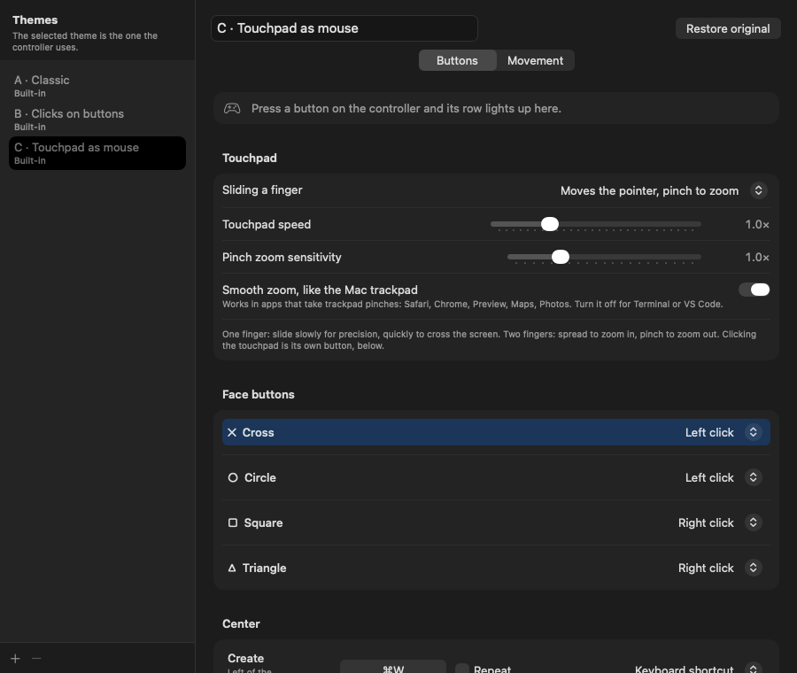

<div align="center">

# 🎮 Gamepad Mouse

**Usa un control de PlayStation 5 como mouse, scroll y atajos de teclado en tu Mac.**<br>
Trabaja con las manos abajo y descansadas, en vez de estirarlas al mouse y al teclado todo el día.

macOS 13+ · Swift · DualSense (PS5) · App de barra de menú · English & Español · [Licencia MIT](LICENSE)

[English](README.md) · [Sitio de documentación](https://jofer95.github.io/gamepad-mouse/)



</div>

## Por qué

Trabajar con agentes de IA implica repetir los mismos movimientos: dictar un prompt, hacer scroll,
clic, regresar, cerrar una ventana, cambiar de app. Gamepad Mouse pone todo eso en un control que
sostienes en el regazo, para que tus muñecas y hombros descansen.

## Funciones

- 🖱️ **Mouse y scroll en los sticks.** El stick izquierdo mueve el puntero con aceleración y el
  derecho hace scroll en las dos direcciones. Un modo precisión los hace más lentos para objetivos
  pequeños.
- ⌨️ **Cualquier botón, cualquier acción.** Clic izquierdo, derecho y central (mantén para arrastrar,
  dos veces rápido para doble clic), atajos de teclado que se repiten, teclas mantenidas para dictar
  con push-to-talk, Mission Control y las ventanas de la app al frente.
- 🎯 **Puntero con giroscopio.** Mantén L2 y gira el control para mover el puntero como un
  apuntador láser, para apuntar con precisión sin tocar los sticks.
- 🎨 **Temas.** Tres mapeos predeterminados y todos los tuyos que quieras, y los cambias desde la
  barra de menú o desde el control.
- 👆 **Touchpad como trackpad.** Desliza un dedo para mover el puntero. Separa o junta dos dedos para
  hacer zoom suave, como en el trackpad de la Mac.
- 🪟 **Ventana de configuración.** La fila de cada botón se ilumina al presionarlo, y los atajos se
  graban presionándolos.
- 🔋 **La batería real.** Se lee directo del control, porque macOS no la reporta por Bluetooth.
- 🔒 **Un candado en el botón de mute.** Presiona mute y nada más hace algo hasta que lo vuelvas a
  presionar, con la barra de luz en rojo tenue y una vibración para avisarte. También puede bloquearse
  solo después de un rato.
- 💡 **Estado en la barra de luz.** Azul con el mapeo activo, naranja en pausa y rojo tenue con el
  candado.
- 🌎 **Inglés y español.** La app sigue el idioma de tu Mac.

## Requisitos

- macOS 13 Ventura o posterior
- Xcode o las Xcode Command Line Tools (Swift 5.9+)
- Un control DualSense (PS5), por Bluetooth o USB-C. Otros controles que macOS reconoce deberían
  funcionar con los sticks y botones; el touchpad, la batería y el zoom son solo del DualSense.

## Instalar

```bash
git clone https://github.com/jofer95/gamepad-mouse.git
cd gamepad-mouse
./scripts/build-app.sh --install
```

Compila la app, la firma, la copia a `~/Applications` y la abre. Busca el ícono del control en la
barra de menú.

### La primera vez

1. **Permite Accesibilidad.** macOS lo pide la primera vez. Activa **GamepadMouse** en *Ajustes del
   Sistema → Privacidad y seguridad → Accesibilidad*. Sin esto la app no puede mover el puntero ni
   teclear. El ícono de la barra muestra ⚠️ mientras falte.
2. **Conecta el control.** La primera vez, emparéjalo por Bluetooth (abajo), o conecta un cable USB-C
   de datos, que no necesita emparejarse.

### Emparejar un DualSense por Bluetooth

Solo se hace una vez. Después, presionar **PS** lo vuelve a conectar a la Mac.

1. **Apaga el control.** Si tiene alguna luz encendida, mantén **PS** unos 10 segundos hasta que se
   apague. Si hay un PS5 cerca y encendido, apágalo también, o el control se conectará a él.
2. **Ponlo en modo de emparejamiento.** Mantén **Create** (el botón pequeño a la izquierda del
   touchpad) y **PS** al mismo tiempo unos 3–5 segundos, hasta que la luz alrededor del touchpad
   **parpadee rápido, de dos en dos**. Un pulso lento significa que intenta reconectarse a su último
   dispositivo, no que se está emparejando: suelta, apágalo e inténtalo de nuevo.
3. **Conéctalo en la Mac.** Abre *Ajustes del Sistema → Bluetooth*. **DualSense Wireless Controller**
   aparece en *Dispositivos cercanos*; haz clic en **Conectar**. Si no aparece en un minuto, repite
   el paso 2.
4. **Listo.** La barra de luz se queda encendida y se prende la luz de jugador debajo del touchpad.
   Con Gamepad Mouse abierto, la barra de luz se pone azul.

<details>
<summary><b>Problemas al emparejar</b></summary>

- **No aparece en Bluetooth:** el modo de emparejamiento dura más o menos un minuto. Mantén
  **Create + PS** otra vez y deja abierto *Ajustes del Sistema → Bluetooth* mientras parpadea.
- **Ya estaba emparejado pero no se conecta:** en *Ajustes del Sistema → Bluetooth*, haz clic en ⓘ
  junto al control, elige **Olvidar este dispositivo** y emparéjalo de nuevo.
- **También juegas en un PS5:** el control recuerda una consola o computadora a la vez. Después de
  usarlo en el PS5 (o de conectarlo ahí por cable), emparéjalo con la Mac otra vez.
- **Sin Bluetooth:** un cable USB-C de datos lo conecta al momento y lo carga al mismo tiempo. El
  micrófono solo funciona por cable.

</details>

## Temas

Un tema es un mapeo completo de los botones. Elígelo en la barra de menú (**Tema**) o en
**Configurar botones…**. Los predeterminados:

| Control | A · Clásico | B · Clics en botones | C · Touchpad como mouse |
|---|---|---|---|
| Stick izquierdo | Puntero | Puntero | Puntero |
| Stick derecho | Scroll | Scroll | Scroll |
| ✕ Cruz | Dictar (mantener) | Clic izquierdo | Clic izquierdo |
| ○ Círculo | Cerrar ventana `⌘W` | Clic izquierdo | Clic izquierdo |
| □ Cuadrado | Precisión (mantener) | Clic derecho | Clic derecho |
| △ Triángulo | Enter | Clic derecho | Clic derecho |
| Clic del touchpad | Clic izquierdo | Dictar (mantener) | Dictar (mantener) |
| Deslizar en el touchpad | — | — | Puntero, pellizcar para zoom |
| Create | Escape | Cerrar ventana `⌘W` | Cerrar ventana `⌘W` |
| Options | App anterior `⌘Tab` | Enter | Enter |
| L1 / R1 | Atrás / Adelante | Atrás / Adelante | Atrás / Adelante |
| L2 | Clic derecho | Puntero con giroscopio (mantener) | Puntero con giroscopio (mantener) |
| R2 | Clic izquierdo | — | — |
| D-pad ↑ / ↓ | Flechas | Mission Control / Ventanas de la app | Mission Control / Ventanas de la app |
| D-pad ← / → | Flechas | Flechas | Flechas |
| R3 | Clic central | Clic central | Clic central |
| PS | — | — | — |
| 🎙️ Mute | Bloquear / desbloquear | Bloquear / desbloquear | Bloquear / desbloquear |

El botón de mute siempre bloquea y desbloquea; no es parte de un tema. **Dictar** mantiene `⇧⌃` mientras sostienes el botón. Configura ese atajo como push-to-talk en tu app
de dictado (Wispr Flow, Superwhisper, …) o graba el tuyo en la ventana de configuración. Atrás y
adelante mandan `⌘[` y `⌘]`.

## Touchpad

En un tema con el touchpad en **Mueve el puntero, pellizca para zoom** (el tema C):

- **Un dedo** mueve el puntero. Desliza lento para precisión y rápido para cruzar la pantalla.
  Apoyar el dedo no mueve el puntero; solo cuenta lo que deslizas.
- **Dos dedos** hacen zoom. Sepáralos para acercar y júntalos para alejar.
  - **Zoom suave** (por defecto) manda un pellizco real de trackpad, así que sigue tus dedos.
    Funciona en apps que aceptan el pellizco del trackpad: Safari, Chrome, Vista Previa, Mapas,
    Fotos.
  - Desactiva el zoom suave para hacer zoom **por pasos** con `⌘=` / `⌘-`, que funciona en casi
    todas las apps, también en la Terminal y VS Code.
- El **clic** del touchpad es un botón aparte que puedes asignar a lo que quieras.

## Puntero con giroscopio

En los temas B y C, mantén **L2** y gira el control: el puntero lo sigue como un apuntador láser. Se
mueve según qué tan rápido giras, así que con el control quieto el puntero no se mueve; los giros
lentos apuntan con precisión y los rápidos cruzan la pantalla. Suelta L2 para mover el control
libremente; vuelve a presionarlo para seguir desde donde está el puntero, como levantar el mouse de
la mesa.

En **Configurar botones… → Movimiento → Puntero con giroscopio** puedes ajustar la sensibilidad, elegir
si izquierda y derecha salen de **girar** el control (como una linterna) o de **ladearlo** (como un
volante, cómodo con el control en el regazo), e invertir cualquier dirección. Cualquier botón puede
ser puntero con giroscopio: elige **Puntero con giroscopio (mantener)** como su acción.

## Candado

Presiona el botón de **mute** (debajo del logo de PS) para bloquear el control. Ningún otro botón,
stick ni el touchpad hacen nada, se suelta lo que estuviera presionado, la barra de luz queda en rojo
tenue y el control vibra una vez. Presiona mute otra vez para desbloquear: vibra dos veces y la luz
regresa. También puedes bloquearlo desde la barra de menú (**Bloquear el control**, `⌘L` con el menú
abierto).

En **Configurar botones… → Movimiento → Candado** puedes pedir que haya que mantener mute medio segundo
para desbloquear, y que el control se bloquee solo después de 2 a 30 minutos sin usarlo. Las dos
opciones vienen apagadas.

## Configurar

Abre el ícono de la barra de menú → **Configurar botones…** (`⌘,`).

- **Temas** a la izquierda. El seleccionado es el que está activo. **+** lo copia a un tema nuevo y
  **−** lo borra. Los predeterminados no se pueden borrar, pero **Restaurar original** los regresa a
  como venían.
- Pestaña **Botones**: cada botón con su acción. Presiona un botón del control y su fila se ilumina.
  Para cambiar un atajo, haz clic en él y presiona las teclas nuevas. Para atajos de solo
  modificadores, como `⇧⌃`, presiónalos y suéltalos.
- Pestaña **Movimiento**: velocidad del puntero, del scroll y del touchpad, curvas de respuesta,
  velocidad en modo precisión, zona muerta de los sticks y qué stick mueve el puntero. Aplican a
  todos los temas.

Los cambios se aplican al momento y se guardan solos.

<details>
<summary><b>El archivo de configuración</b></summary>

Todo vive en `~/Library/Application Support/GamepadMouse/config.json`. **Editar archivo JSON…** en el
menú lo abre y **Recargar archivo JSON** lo vuelve a leer. Si el archivo tiene un error, la app te
avisa y sigue con la configuración anterior. Los valores aceptados están en la tabla del
[README en inglés](README.md#configure).

</details>

## Idioma

La app sale en inglés o en español, el que aparezca primero en *Ajustes del Sistema → General →
Idioma y región*. Para usar otro solo en esta app, agrégala en **Aplicaciones** dentro de esa misma
pantalla. Los temas que renombres conservan tu nombre en cualquier idioma.

## Solución de problemas

<details>
<summary><b>macOS dice que la app "contiene malware" y la manda a la Papelera</b></summary>

La app se firmó con un certificado revocado, y macOS trata como malware cualquier app firmada con
uno. El script de compilación ya descarta los certificados revocados, así que vuelve a compilar con
`./scripts/build-app.sh --install`. Para elegir un certificado tú mismo, lístalos con
`security find-identity -v -p codesigning` y corre `SIGN_IDENTITY=<SHA-1> ./scripts/build-app.sh --install`.

</details>

<details>
<summary><b>El control está conectado pero no se mueve nada</b></summary>

- Revisa que Accesibilidad esté permitida: el menú dice **Accesibilidad: permitida**.
- Revisa que no esté bloqueado (barra de luz en rojo tenue, 🔒 en la barra de menú): presiona **mute**.
- Revisa que el mapeo no esté en pausa (barra de luz naranja, ⏸ en la barra de menú): elige
  **Activado** en el menú.

</details>

<details>
<summary><b>macOS pide Accesibilidad otra vez después de cada compilación</b></summary>

La app se firmó ad-hoc porque no se encontró ningún certificado, y una firma ad-hoc cambia en cada
compilación. Instala Xcode e inicia sesión con un Apple ID (sirve uno gratuito), o crea un
certificado de firma de código autofirmado en Acceso a Llaveros. El script lo usará solo.

</details>

<details>
<summary><b>El zoom suave no hace nada</b></summary>

El zoom suave solo funciona en apps que aceptan el pellizco del trackpad, y usa campos de gestos no
documentados de macOS que una actualización podría cambiar. Desactiva **Zoom suave** en
**Configurar botones… → Touchpad** para hacer zoom por pasos con `⌘=` / `⌘-`.

</details>

<details>
<summary><b>Usar el micrófono del control</b></summary>

El micrófono del DualSense solo funciona con cable USB-C. Conéctalo y elige **DualSense Wireless
Controller** como entrada en tu app de dictado o en *Ajustes del Sistema → Sonido*.

</details>

## Cómo funciona

- El framework **GameController** de Apple lee los sticks y los botones.
  `GCController.shouldMonitorBackgroundEvents` hace que la entrada llegue aunque la app no esté al
  frente (una app de barra de menú nunca lo está).
- Un timer a 120 Hz convierte ese estado en eventos **CGEvent** de mouse, scroll y teclado. Los
  atajos con modificadores también mandan el evento de cada tecla modificadora, para apps que
  escuchan esas teclas, como el push-to-talk.
- **IOKit HID** lee de los reportes del DualSense lo que GameController no da: la batería y los dos
  dedos del touchpad, con el momento exacto en que se apoyan y se levantan, el botón de mute y el
  giroscopio. El formato coincide con
  el driver `hid-playstation` de Linux.
- El **zoom suave** publica eventos de gesto de pellizco del trackpad con campos de CGEvent no
  documentados, igual que otras herramientas de entrada para macOS.

El código está en `Sources/GamepadMouse/`; la tabla de archivos está en el
[README en inglés](README.md#how-it-works).

## Lo que sigue

- Vibración y luz como confirmación de clics, dictado y cambios de tema.
- Gestos en el touchpad y scroll con dos dedos.
- Gatillos adaptativos con un punto de clic físico.
- Temas por app.

## Contribuir

Los issues y pull requests son bienvenidos. Para trabajar en la app:

```bash
swift build                      # compilar
./scripts/build-app.sh --install # compilar, firmar, instalar y reabrir
```

Escribe cada texto visible en los dos idiomas con `tr("English", "Español")`.

## Licencia

[MIT](LICENSE). Úsalo, cámbialo, compártelo.
