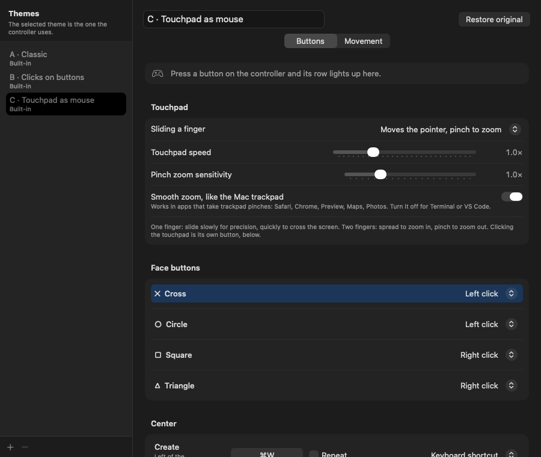

<div align="center">

# 🎮 Gamepad Mouse

**Use a PlayStation 5 controller as your Mac's mouse, scroll wheel and keyboard shortcuts.**<br>
Work with your hands resting low instead of reaching for the mouse and keyboard all day.

macOS 13+ · Swift · DualSense (PS5) · Menu bar app · English & Español · [MIT License](LICENSE)

[Español](README.es.md) · [Docs site](docs/index.html)



</div>

## Why

Working with AI agents means a lot of the same moves: dictate a prompt, scroll, click, go back,
close a window, switch apps. Gamepad Mouse puts all of that on a controller you can hold in your lap,
so your wrists and shoulders get a break.

## Features

- 🖱️ **Mouse and scroll on the sticks.** The left stick moves the pointer with an acceleration curve,
  the right stick scrolls both ways. A precision mode slows both down for small targets.
- ⌨️ **Any button, any action.** Left, right and middle click (hold to drag, tap twice to
  double-click), keyboard shortcuts with auto-repeat, held keys for push-to-talk dictation, Mission
  Control and the front app's windows.
- 🎨 **Themes.** Three built-in mappings and as many of your own as you like, switched from the menu
  bar or from the controller.
- 👆 **Touchpad as a trackpad.** Slide one finger to move the pointer. Spread or pinch two fingers to
  zoom smoothly, the way a Mac trackpad does.
- 🪟 **A settings window.** Each button's row lights up when you press it, and shortcuts are recorded
  by pressing them.
- 🔋 **The real battery level.** Read straight from the controller, since macOS doesn't report it
  over Bluetooth.
- 💡 **Light bar status.** Blue while mapping is on, orange while paused.
- 🌎 **English and Spanish.** The app follows your Mac's language.

## Requirements

- macOS 13 Ventura or later
- Xcode or the Xcode Command Line Tools (Swift 5.9+)
- A DualSense (PS5) controller, over Bluetooth or USB-C. Other controllers macOS supports should work
  for the sticks and buttons; the touchpad, battery and pinch are DualSense-only.

## Install

```bash
git clone https://github.com/jofer95/gamepad-mouse.git
cd gamepad-mouse
./scripts/build-app.sh --install
```

This builds the app, signs it, copies it to `~/Applications` and opens it. Look for the controller
icon in the menu bar.

### First run

1. **Allow Accessibility.** macOS asks the first time. Turn on **GamepadMouse** in *System Settings →
   Privacy & Security → Accessibility*. Without it the app can't move the pointer or type. The menu
   bar icon shows ⚠️ until it's allowed.
2. **Connect the controller.** To pair a DualSense, hold **PS + Create** until the light bar blinks,
   then pick it in *System Settings → Bluetooth*. A USB-C data cable works too.

## Themes

A theme is a complete button mapping. Pick one from the menu bar (**Theme**) or in
**Configure Buttons…**. The built-in ones:

| Control | A · Classic | B · Clicks on buttons | C · Touchpad as mouse |
|---|---|---|---|
| Left stick | Pointer | Pointer | Pointer |
| Right stick | Scroll | Scroll | Scroll |
| ✕ Cross | Dictate (hold) | Left click | Left click |
| ○ Circle | Close window `⌘W` | Left click | Left click |
| □ Square | Precision (hold) | Right click | Right click |
| △ Triangle | Return | Right click | Right click |
| Touchpad click | Left click | Dictate (hold) | Dictate (hold) |
| Touchpad slide | — | — | Pointer, pinch to zoom |
| Create | Escape | Close window `⌘W` | Close window `⌘W` |
| Options | Last app `⌘Tab` | Return | Return |
| L1 / R1 | Back / Forward | Back / Forward | Back / Forward |
| L2 / R2 | Right / Left click | — | — |
| D-pad ↑ / ↓ | Arrows | Mission Control / App windows | Mission Control / App windows |
| D-pad ← / → | Arrows | Arrows | Arrows |
| R3 | Middle click | Middle click | Middle click |
| PS | Pause / resume | Pause / resume | Pause / resume |

**Dictate** holds `⇧⌃` while the button is down. Set your dictation app's push-to-talk (Wispr Flow,
Superwhisper, …) to that shortcut, or record your own in the settings window. Back and forward send
`⌘[` and `⌘]`.

## Touchpad

With a theme whose touchpad is set to **Moves the pointer, pinch to zoom** (theme C):

- **One finger** moves the pointer. Slide slowly for precision, quickly to cross the screen. Putting
  a finger down never moves the pointer; only sliding does.
- **Two fingers** zoom. Spread to zoom in, pinch to zoom out.
  - **Smooth zoom** (default) sends a real trackpad pinch, so it follows your fingers. It works in
    apps that take trackpad pinches: Safari, Chrome, Preview, Maps, Photos.
  - Turn smooth zoom off to zoom in **steps** with `⌘=` / `⌘-` instead, which works almost everywhere,
    Terminal and VS Code included.
- **Clicking** the touchpad is a separate button you can map to anything.

## Configure

Open the menu bar icon → **Configure Buttons…** (`⌘,`).

- **Themes** on the left. The selected one is live. **+** copies it into a new theme, **−** deletes
  it. Built-in themes can't be deleted, but **Restore original** puts them back the way they shipped.
- **Buttons** tab: every button and its action. Press a controller button and its row lights up. To
  change a shortcut, click it and press the new keys. For modifier-only shortcuts like `⇧⌃`, press
  and release them.
- **Movement** tab: pointer, scroll and touchpad speeds, response curves, precision speed, stick dead
  zone, and which stick moves the pointer. These apply to every theme.

Changes apply right away and save themselves.

<details>
<summary><b>The config file</b></summary>

Everything lives in `~/Library/Application Support/GamepadMouse/config.json`. **Edit JSON File…** in
the menu opens it and **Reload JSON File** reads it again. If the file has an error, the app tells
you and keeps the previous settings.

```json
{
  "activeThemeID": "c",
  "settings": { "pointerMaxSpeed": 1600, "touchpadSpeed": 1.0, "smoothZoom": true },
  "themes": [
    {
      "id": "c",
      "name": "C · Touchpad as mouse",
      "touchpad": "pointer",
      "buttons": {
        "cross":    { "type": "leftClick" },
        "create":   { "type": "shortcut", "key": "w", "modifiers": ["cmd"] },
        "touchpad": { "type": "holdKey", "modifiers": ["shift", "ctrl"] },
        "dpadLeft": { "type": "shortcut", "key": "left", "repeat": true }
      }
    }
  ]
}
```

| | Values |
|---|---|
| Buttons | `cross` `circle` `square` `triangle` `l1` `r1` `l2` `r2` `l3` `r3` `dpadUp` `dpadDown` `dpadLeft` `dpadRight` `options` `create` `ps` `touchpad` |
| Action `type` | `leftClick` `rightClick` `middleClick` `shortcut` (`key`, `modifiers`, optional `repeat`) `holdKey` (`key` and/or `modifiers`) `precision` `missionControl` `appWindows` `toggleEnabled` `nextTheme` `none` |
| `touchpad` | `none` or `pointer` |
| Modifiers | `cmd` `shift` `option` `ctrl` `fn` |
| Keys | letters, digits, `return` `tab` `space` `delete` `escape` `up` `down` `left` `right` `home` `end` `pageup` `pagedown` `f1`–`f12`, and `[` `]` `,` `.` `/` `;` `'` `-` `=` `` ` `` `\` |
| Settings | `pointerMaxSpeed` `pointerCurve` `scrollMaxSpeed` `scrollCurve` `invertScrollVertical` `invertScrollHorizontal` `precisionFactor` `deadzone` `pointerStick` (`left`/`right`) `touchpadSpeed` `pinchSensitivity` `smoothZoom` |

A button left out of a theme does nothing.

</details>

## Language

The app shows in English or Spanish, whichever comes first in *System Settings → General → Language &
Region*. To use a different one only for this app, add it under **Applications** on that same screen.
Themes you rename keep your name in either language.

## Troubleshooting

<details>
<summary><b>macOS says the app "contains malware" and moves it to the Trash</b></summary>

The app was signed with a revoked certificate; macOS treats any app signed with one as malware. The
build script skips revoked certificates, so rebuild with `./scripts/build-app.sh --install`. To choose
a certificate yourself, list them with `security find-identity -v -p codesigning` and run
`SIGN_IDENTITY=<SHA-1> ./scripts/build-app.sh --install`.

</details>

<details>
<summary><b>The controller is connected but nothing moves</b></summary>

- Check that Accessibility is allowed: the menu shows **Accessibility: allowed**.
- Check that mapping isn't paused: the light bar is orange and the menu icon shows ⏸ while paused.
  Press **PS** or choose **Enabled** in the menu.

</details>

<details>
<summary><b>macOS asks for Accessibility again after every build</b></summary>

The build was signed ad-hoc because no signing certificate was found, and an ad-hoc signature
changes with every build. Install Xcode and sign in with an Apple ID (a free one works), or create a
self-signed code signing certificate in Keychain Access. The script then uses it automatically.

</details>

<details>
<summary><b>Smooth zoom does nothing</b></summary>

Smooth zoom only works in apps that take trackpad pinches, and it relies on undocumented macOS
gesture fields that a macOS update could change. Turn off **Smooth zoom** in **Configure Buttons… →
Touchpad** to zoom in steps with `⌘=` / `⌘-`.

</details>

<details>
<summary><b>Using the controller's microphone</b></summary>

The DualSense microphone only works over a USB-C cable. Plug it in and pick **DualSense Wireless
Controller** as the input in your dictation app or in *System Settings → Sound*.

</details>

## How it works

- Apple's **GameController** framework reads the sticks and buttons.
  `GCController.shouldMonitorBackgroundEvents` keeps input coming while the app isn't in front (a
  menu bar app never is).
- A 120 Hz timer turns that state into **CGEvent** mouse, scroll and keyboard events. Shortcuts with
  modifiers also send each modifier's key event, for apps that watch the modifier keys themselves,
  like push-to-talk.
- **IOKit HID** reads what GameController doesn't expose from the DualSense's own input reports: the
  battery, and both touchpad fingers with their touch-down and lift. The byte layout matches the Linux
  `hid-playstation` driver.
- **Smooth zoom** posts trackpad magnify gesture events through undocumented CGEvent fields, the same
  approach other macOS input tools use.

| File | What it does |
|---|---|
| `Engine.swift` | The 120 Hz loop: buttons to actions, sticks and touchpad to pointer, scroll and zoom |
| `InputSynthesizer.swift` | Posts mouse, scroll, keyboard and pinch events |
| `ControllerManager.swift` | Controller connection, buttons, sticks, battery text and light bar |
| `DualSenseHID.swift` | Battery and touchpad fingers from the DualSense HID reports |
| `Config.swift` | Buttons, actions, themes and the config file format |
| `ConfigStore.swift` | The live config: theme and button changes, saving |
| `SettingsView.swift` · `ShortcutRecorder.swift` | The settings window (SwiftUI) and its shortcut recorder |
| `AppDelegate.swift` | Menu bar, settings window, permissions, open at login |
| `SystemActions.swift` · `KeyCodes.swift` · `L10n.swift` | Mission Control, key codes, English and Spanish text |

All sources are in `Sources/GamepadMouse/`.

## Roadmap

- Gyro pointer: tilt the controller to move the pointer while holding a button.
- Haptic and light bar feedback for clicks, dictation and theme changes.
- The mute button as a lock that ignores every other button.
- Touchpad gestures and two-finger scroll.
- Adaptive triggers with a physical click point.
- Per-app themes.

## Contributing

Issues and pull requests are welcome. To work on the app:

```bash
swift build                      # compile
./scripts/build-app.sh --install # build, sign, install and relaunch
```

Keep every user-facing string in both languages with `tr("English", "Español")`.

## License

[MIT](LICENSE). Use it, change it, share it.
